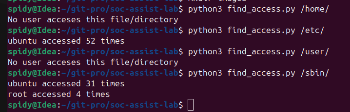
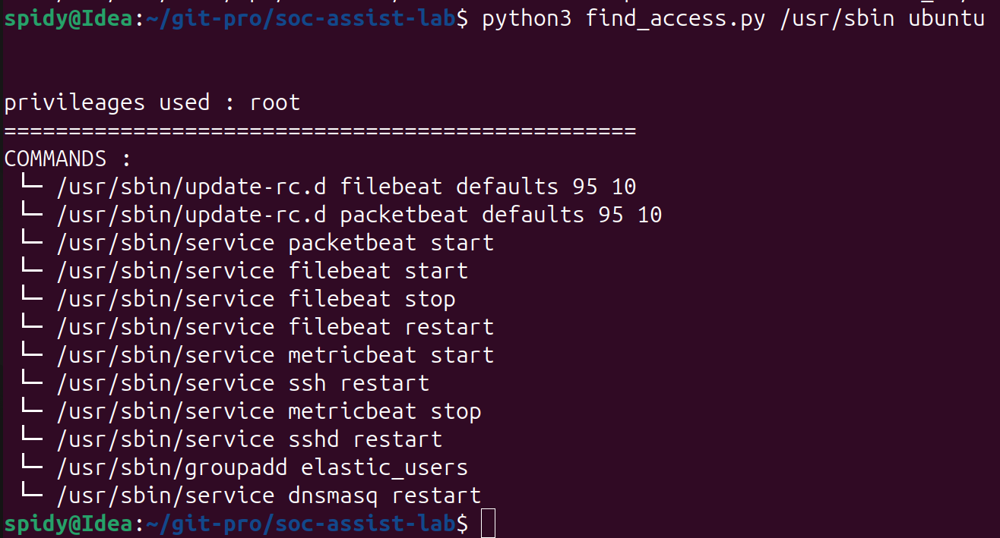
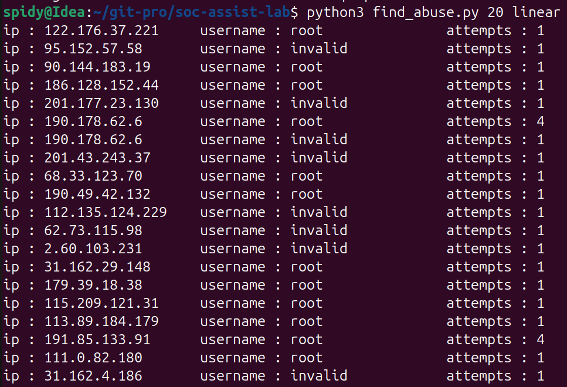
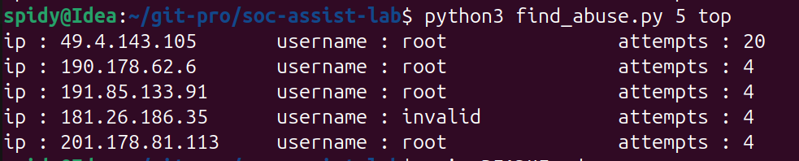

# 🛡️ SOC Assistant Lab (v1.0.0 Legacy)

> **Note:** This document contains the documentation for the initial version 1.0.0 prototype suite of Python command-line tools for SOC log analysis.

This lab consists of three Python command-line tools designed to assist SOC analysts in triaging specific log entries, detecting authentication abusers, and analyzing file access patterns.

---

## ⚙️ Prerequisites & Setup

Before using the **Authentication Abuser** tool or the **Sudo Access** tool, ensure that the log separation script has been executed:

```bash
python3 write.py
```

### Why this is necessary:
`write.py` extracts relevant entries from the source log file and writes them into separate files (`sudo.log` and `sshd.log`). This modular separation allows the tools to process target data efficiently and supports future development extending from discrete log sources.

---

## 🔍 Tooling Reference

### 1. `find_access.py`
This tool allows analysts to query logs and retrieve unique user accounts that accessed a specific file or directory, along with access frequencies and privilege levels.

#### Example 1: Basic File Access Audit
Query unique users and access counts for `/etc/passwd`:

```bash
python3 find_access.py /etc/passwd
```

*Outputs a list of usernames and the total number of times they accessed `/etc/passwd`.*



#### Example 2: Inspecting User Privileges
Drill down to inspect the specific privileges used by a user when accessing a path (e.g., inspecting user `ubuntu` across `/usr`):

```bash
python3 find_access.py /usr ubuntu
```



---

### 2. `find_abuse.py`
This tool identifies top SSH authentication abusers by parsing invalid login attempts. Analysts can filter results linearly or display top abusers in descending order.

#### Example Usage:

* Display top abusers linearly:
  ```bash
  python3 find_abuse.py 20 linear
  ```
* Display top 5 abusers in descending order:
  ```bash
  python3 find_abuse.py 5 top
  ```




---

## 🏷️ Release Details
* **Tag:** `v1.0.0`
* **Status:** Deprecated / Legacy Prototype
